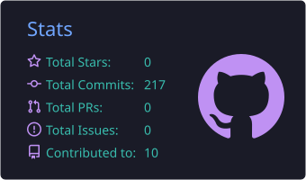
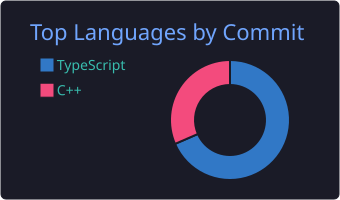

  

  

## 🛰️ Mission Briefing

- 🎓 Third-year B.Tech CSE (Data Science) at **PSIT, Kanpur**
- 🚀 Building full-stack AI products with Next.js, Gemini and Python
- 🌌 Secretary of the **Vyomnauts Club**, the aerospace and space club at my college
- 🎯 Open to **AI/ML Engineer** and **SDE** roles

## 🧪 Mission Log

| Mission | What it does | Stack | Links |
|---|---|---|---|
| **Shortlister** | AI candidate screening with a staged 4-step pipeline, embeddings + Gemini evaluation, explainability, and admin/bias/cost dashboards |  | [Repo](https://github.com/obj8899/shortlister) · [Live](https://shortlister-delta.vercel.app) |
| **PlaylistPilot** | Turns a YouTube playlist into a structured learning roadmap using the YouTube API and Gemini, with a demo mode |  | [Repo](https://github.com/obj8899/playlistpilot) |
| **CryoGuard AI** | Refrigerant leak prediction system: Python model code, a backend, and a Next.js frontend |  | [Repo](https://github.com/obj8899/cryoguard-ai) · [Live](https://sample1-eight-plum.vercel.app) |
| **PulsePoint** | Next.js product frontend with GenKit AI integration and Firebase |  | [Repo](https://github.com/obj8899/pulsepointfinal) · [Live](https://pulsepoint-alpha.vercel.app) |
| **CarAnalyser** | Car purchase affordability analyzer with CSV parsing and interactive charts |  | [Repo](https://github.com/obj8899/caranalyser) · [Live](https://caranalyser.vercel.app) |

## 🧰 Tech Stack

  

**AI/ML:** Google Gemini API · GenKit · embeddings · Python model code

## 📊 Telemetry

  
  

  

  <a href="https://github.com/obj8899/leecode-submissions">DSA practice log in C++ →</a>

## 🐍 Contribution Orbit

  <picture>
    <source media="(prefers-color-scheme: dark)" srcset="https://raw.githubusercontent.com/obj8899/obj8899/output/github-snake-dark.svg" />
    <source media="(prefers-color-scheme: light)" srcset="https://raw.githubusercontent.com/obj8899/obj8899/output/github-snake.svg" />
    
  </picture>

## 🔭 Currently

- Building: SIH prototypes and placement-ready AI projects
- Learning: deeper ML and agentic AI systems
- Practicing: DSA on LeetCode

## 📡 Open Comms

  
  

  

